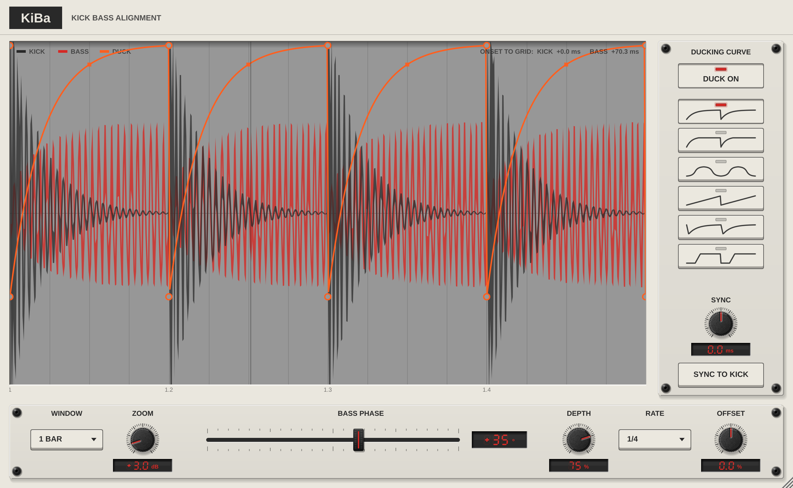
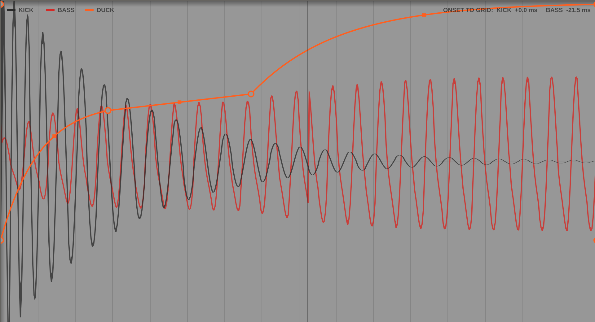
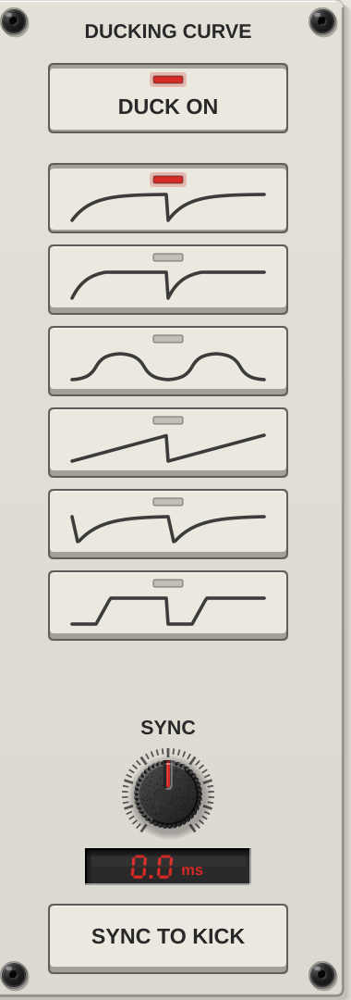
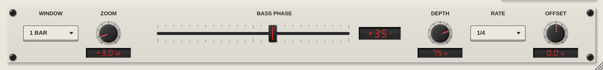

# KiBa – Kick Bass Alignment

KiBa is a VST3 plugin for lining up a bassline with its kick drum. Put it on the bass track and route the kick into its sidechain. The tempo-synced oscilloscope then shows both waveforms on top of each other, together with a ducking curve that you can edit right in the scope. A phase fader turns the phase of the bass until it locks in with the kick.



---

## Features

- **Tempo-synced oscilloscope**
  - Kick (black), bass (red) and ducking gain (orange) on one screen.
  - The window follows the bar grid of the host: 1/16, 1/8, 1/4, 1/2, 1, 2, 4 or 8 bars.
- **Bass phase rotation**
  - Rotates every frequency of the bass by the same angle, from −180° to +180°.
  - Linear phase, and transparent at 0°.
- **Tempo-synced ducking**
  - Six presets: pump, sharp, smooth, linear, soft and hold.
  - Free curve editing with points and bendable segments.
  - Depth, rate (1/16 to 1 bar) and time offset.
- **Sync to kick**
  - Measures where the kick's initial transient starts and puts it exactly onto the grid.
  - Corrects hosts that report a shifted song position for plugins with latency.
- **Onset readout**
  - Shows how far kick and bass start from the nearest beat, in milliseconds.
- **Hardware-style interface**
  - Raised, screwed panels, knurled knobs, a fader with a scale, and seven-segment value displays.
- **Light on the CPU**
  - About 0.4 % of one core for the audio in a Release build. The scope only redraws when new audio arrives.

---

## Getting started (Ableton Live)

1. Insert **KiBa** on the **bass** track.
2. In the plugin's device header, choose the **kick** track as the **Sidechain** input.
3. Press play. Kick and bass appear in the scope.
4. If the kick does not land on the grid line, play a passage with a kick on the beat and press **SYNC TO KICK**.
5. Choose a ducking curve, set **DEPTH**, and move the curve until the dip sits right on the kick.
6. Use **BASS PHASE** to turn the bass until its low end lines up with the kick body.

When the transport is stopped, the scope freezes and the ducking is bypassed. The bass therefore never pumps while you audition without playback.

---

## The scope



| Element | Meaning |
|---|---|
| Black | Kick (sidechain), delayed by the plugin latency so that it lines up with the bass |
| Red | Bass as it leaves the plugin, after phase rotation and ducking |
| Orange | Ducking gain: 0 dB at the top, down to **DEPTH** at the bottom |
| Vertical lines | Bars (strong), beats (medium) and subdivisions (light) |
| Onset to grid | Start of the kick and the bass relative to the nearest beat, in ms |

### Editing the ducking curve

| Action | Result |
|---|---|
| Drag a **point** | Moves it (the first and last points only up and down) |
| Drag a **square** (centre of a segment) | Bends that segment up or down |
| Drag the **curve line** up or down | Also bends that segment |
| Drag **elsewhere**, sideways | Shifts the curve in time (**OFFSET**) |
| Drag **elsewhere**, up or down | Changes the depth (**DEPTH**) |
| **Double-click** an empty spot | Adds a point |
| **Double-click** a point | Removes it |

The handles are shown when one period of the curve is wide enough to edit. If they are hidden, choose a shorter **WINDOW**. The curve is saved with the project.

---

## Controls



### Ducking curve panel

- **DUCK ON** switches the ducking on or off. The LED lights while it is on.
- The **preset buttons** each show their curve over two periods: pump, sharp, smooth, linear, soft and hold. Pressing one loads it as the starting point. The LED marks the preset in use. Once you edit the curve, the LED goes out because the curve is now your own.
- **SYNC** corrects the time base of the scope and of the ducking curve against the host position, from −250 to +250 ms. Double-click resets it to 0.
- **SYNC TO KICK** measures the onset of the last kicks (the median of 8) and sets **SYNC** so that the kick sits on the grid.

<br clear="right">

### Bottom panel



| Control | Range | Description |
|---|---|---|
| **WINDOW** | 1/16 … 8 bars | Length of the scope window. It follows the bar grid and time signature of the host. |
| **ZOOM** | 0 … +24 dB | Vertical zoom of the waveforms |
| **BASS PHASE** | −180° … +180° | Phase rotation of the bass. Double-click resets it to 0°. |
| **DEPTH** | 0 … 100 % | How far the ducking curve pulls the bass down |
| **RATE** | 1/16 … 1 bar | Length of one period of the ducking curve |
| **OFFSET** | −50 … +50 % | Shifts the curve in time, in % of one period. Double-click resets it to 0. |

---

## How it works

### Phase rotation

The bass is rotated by the angle φ, the same for every frequency:

```
y = cos(φ) · x  −  sin(φ) · H{x}
```

- `H` is a Hilbert transformer: a linear-phase FIR with a Kaiser window (β = 6).
- `x` is delayed by the same amount, so at 0° the signal passes unchanged.
- At 48 kHz the 90° path is flat within 0.2 dB from 20 Hz upwards. The measured error of the rotation is below 0.0002 at every angle.
- The FIR runs as a uniformly partitioned overlap-save convolution with 256-sample partitions.
- Both channels share one complex FFT (left + i·right). Because the impulse response is real, one forward and one inverse transform serve both channels.
- The impulse response is set synchronously in `prepareToPlay`, so offline rendering is correct from the very first sample.

### Latency

KiBa reports a constant latency of **2047 samples** (42.6 ms at 48 kHz) at any angle. At higher sample rates the filter grows with the sample rate. The host compensates this latency.

How hosts report the song position to a plugin with latency differs, especially for sidechain inputs. In Ableton Live the scope can therefore appear shifted. **SYNC TO KICK** measures the real offset once, and the value is stored with the project.

### Ducking

- The curve is a list of points, each with a bend for the segment that follows it: `(e^{k·u} − 1) / (e^k − 1)` with `k = 8 · bend`.
- The audio thread reads it as a 2048-point table with linear interpolation.
- The editor sends changes through the plugin state, a `ValueTree`. The audio thread picks up a new table with a try-lock and never waits.
- A 0.3 ms smoothing removes clicks at steep edges.

### Kick onset detection

- A kick starts when a fast envelope (2 ms release) rises well above a slow one (50 ms).
- From there the detector looks back to the first rise of the envelope, which is the click transient, accurate to the sample.
- The offset to the nearest beat of the last 8 kicks feeds both the readout and **SYNC TO KICK**.

---

## Building

### Requirements

- CMake 3.22 or newer
- A C++20 compiler (developed with MSVC / Visual Studio 2022 on Windows)
- [JUCE](https://github.com/juce-framework/JUCE) 8, included as a git submodule in `libs/JUCE`

### Clone and build

```bash
git clone --recursive <repository-url> KiBa
cd KiBa
cmake -B build
cmake --build build --config Release --target KiBa_VST3
```

The plugin ends up in `build/KiBa_artefacts/Release/VST3/KiBa.vst3`. Copy it, or link it, into your VST3 folder (on Windows `C:\Program Files\Common Files\VST3`), for example as a junction from an administrator command prompt:

```bat
mklink /J "C:\Program Files\Common Files\VST3\KiBa.vst3" "<path-to-KiBa>\build\KiBa_artefacts\Release\VST3\KiBa.vst3"
```

> **Notes**
> - Close the DAW before building. A loaded plugin locks the file, and the linker then fails with LNK1104 / LNK1168.
> - Use **Release** (or **RelWithDebInfo**) for actual work. Debug builds are 10–20 times slower.

The CMake option `KIBA_BUILD_PLUGIN_HOST` (on by default) also builds JUCE's AudioPluginHost for debugging. Turn it off with `-DKIBA_BUILD_PLUGIN_HOST=OFF`.

---

## Project structure

```
KiBa/
├── CMakeLists.txt
├── libs/JUCE/               JUCE (git submodule)
├── docs/                    screenshots for this README
└── source/
    ├── PluginProcessor.*    audio: phase rotation, ducking, scope data, onset detection
    ├── PluginEditor.*       window layout and controls
    ├── Views.h              scope (incl. curve editing) and preset buttons
    ├── Ducking.h            curve model, presets, table for the audio thread
    ├── PhaseRotator.h       Hilbert FIR, partitioned convolver, delay
    ├── KiBaLookAndFeel.h    knobs, buttons with LEDs, fader, seven-segment displays
    └── Style.h              panels, screws, displays
```

---

## Tested with

- pluginval at strictness level 7
- Ableton Live (Windows, VST3)
